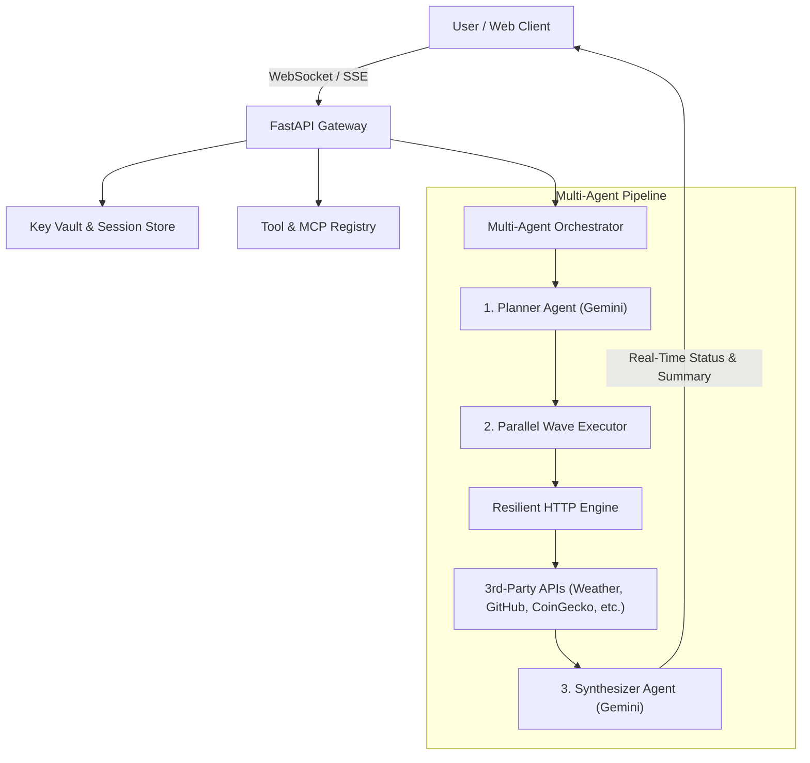

# Adaptive API Kitchen & Multi-Agent Orchestrator

A production-grade, dynamic tool-generating multi-agent backend powered by Google Gemini (`google-genai` SDK), FastAPI, and real-time WebSocket / SSE streaming.

---

## 🌟 Key Features

- **Dynamic API Kitchen & Key Vault**: Secure in-memory session vault for 3rd-party API credentials, automatic schema inspection, and on-demand live credential injection.
- **Dynamic Tool & MCP Registry**: Converts active API schemas and Model Context Protocol (MCP) servers into official Google Gemini `types.Tool` and `types.FunctionDeclaration` specifications.
- **Multi-Agent Wave Orchestrator**:
  1. **Planner Agent**: Analyzes the prompt and kitchen connectors to formulate parallel execution waves.
  2. **Executor Agent**: Concurrently dispatches requests via `asyncio.gather` with resilience handling.
  3. **Synthesizer Agent**: Merges multi-source live responses into structured executive summaries and insights.
- **Resilient HTTP Engine**: Automatic exponential backoff for rate limits (`429`) and server errors (`5xx`), plus Gemini self-healing parameter repair for `400 Bad Request`.
- **Real-time Streaming**: Full streaming support over Server-Sent Events (`/api/stream`) and WebSockets (`/ws/execute`).
- **Interactive Web Interface**: Complete single-page dashboard (`index.html`) with TypeScript/JavaScript frontend bridge (`frontend_bridge.js`).

---

## 🏗️ System Architecture



---

## 🚀 Quick Start

### 1. Prerequisites

- Python 3.10+
- (Optional) Docker & Docker Compose

### 2. Installation

Clone the repository and install dependencies:

```bash
git clone https://github.com/manopriyan88-tech/vazhi-mozhi.git
cd vazhi-mozhi

python -m venv .venv
# On Windows:
.venv\Scripts\activate
# On Linux/macOS:
source .venv/bin/activate

pip install -r requirements.txt
```

### 3. Environment Configuration

Copy `.env.example` to `.env`:

```bash
cp .env.example .env
```

Set your Gemini API key:
```env
GEMINI_API_KEY=your_gemini_api_key_here
GEMINI_MODEL=gemini-2.5-flash
```

*(Note: If `GEMINI_API_KEY` is not provided, the system automatically falls back to heuristic planning and synthesis mode for offline local development).*

### 4. Running the Server

```bash
uvicorn app.main:app --host 0.0.0.0 --port 8000 --reload
```

Open `http://localhost:8000/health` to verify the service status, or open `index.html` in your browser to interact with the web dashboard.

---

## 🧪 Testing & Verification

Run the full pytest suite (60+ unit and integration tests):

```bash
pytest
```

Run the standalone live flow verification script:

```bash
python test_live_flow.py
```

Run the end-to-end integration test (starts server, registers mock key, runs orchestrator, validates Gemini tool invocation):

```bash
python test_integration.py
```

---

## 🐳 Docker Deployment

Build and start with Docker Compose:

```bash
docker-compose up --build -d
```

---

## 📄 License

MIT License.
